# Class and package diagrams

Five diagrams rather than one, because they answer different questions and a single
picture of 240 files answers none of them:

1. [Packages and the direction they depend in](#1-packages) — the structure argument.
2. [The API layer](#2-the-api-layer) — the only genuinely class-shaped part.
3. [The domain model](#3-the-domain-model) — the entities and their multiplicities.
4. [A feature in detail: moderation](#4-a-feature-in-detail-moderation) — how a screen is put together.
5. [The shell](#5-the-shell) — routing, session and the authenticated layout.

## Why each diagram appears twice

Every diagram below is committed as a **PNG above its own source**. The coursework is handed in
as a PDF, and a PDF renders no Mermaid: a reader of the exported document would otherwise get
six fenced code blocks where the diagrams should be. The source stays underneath, collapsed,
because it is what the diagram is maintained as - the picture is a build artefact of it, not a
second copy to edit.

Regenerate after editing any block: the images in [diagrams/](diagrams/) are rendered from the
fences in this file with Mermaid in the Chromium that Playwright already caches, so there is no
extra dependency to install. The renderer lives in the session scratchpad rather than in the
repository, for the same reason the layout audit's measuring spec does.

## Notation

Standard UML, in Mermaid.

| Arrow | Means |
| --- | --- |
| `A --|> B` | **Generalisation.** A is a B. |
| `A ..|> B` | **Realisation.** A implements the interface B. |
| `A --> B` | **Association / navigability.** A holds or uses B. |
| `A *-- B` | **Composition.** B does not exist without A. |
| `A ..> B` | **Dependency.** A refers to B without holding it. |
| `A "1" --> "0..*" B` | Multiplicity on an association. |

Stereotypes are `<<package>>`, `<<interface>>`, `<<abstract>>`, `<<component>>`
(a React function component), `<<hook>>` and `<<module>>` (a file of functions,
not a class).

**No accessors are shown.** Getters and setters are not design. What is listed on a
class is the operations that carry meaning.

Names in the diagrams map to paths under `src/`, with `_` standing in for `/`:
`api_client` is `src/api/client`, `features_moderation` is
`src/features/moderation`, `domain` is `src/domain`.

---

## 1. Packages

The layering rule the codebase actually follows: **a package may depend downward and
sideways within its own layer, never upward.** `src/api` does not know that features
exist; `src/domain`, `src/utils` and `src/theme` import nothing from `@/` at all.

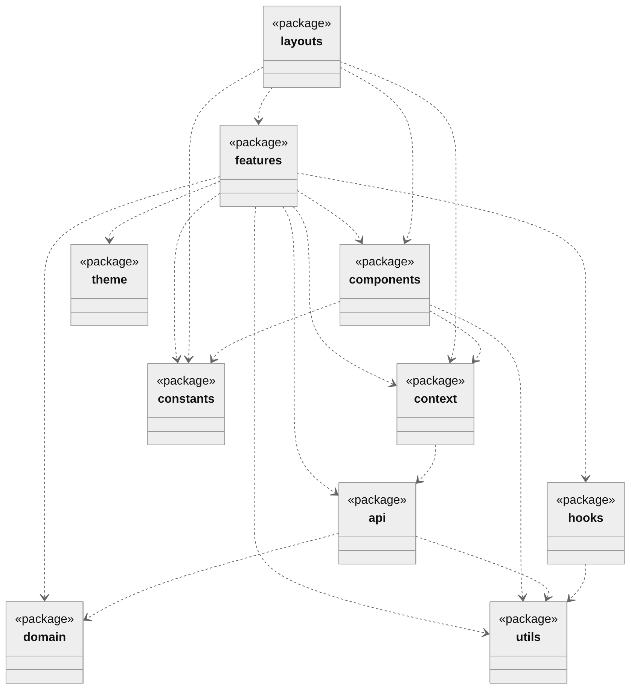

Diagram source (Mermaid)

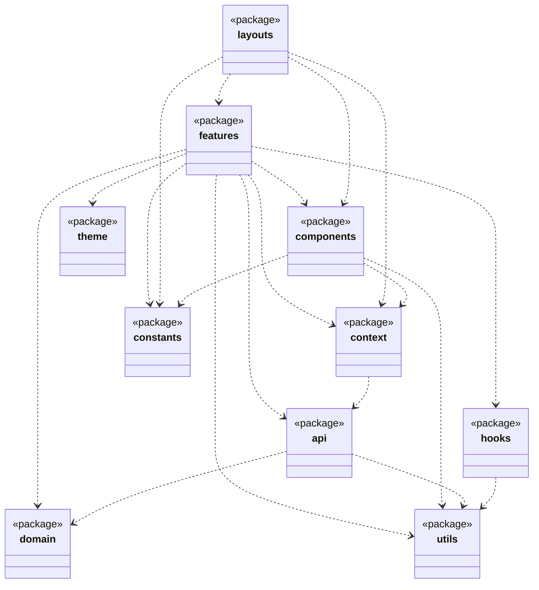

**Nothing points back up, and that is checked rather than claimed.** `src/api` holds
no import of `@/features`, `@/hooks`, `@/components`, `@/layouts` or `@/context`;
`src/domain`, `src/utils` and `src/theme` hold no `@/` import of any kind;
`src/components` holds no import of `@/features`.

**There are no cycles either, and that claim used to be weaker than it read.** It
had been checked once, by hand, and only *between packages* — which is why it missed
three cycles inside features, where a type declared on the module that renders it
was imported back by the hook that produces it. All three were `import type`, so
nothing failed at runtime and every one of them was still a real edge on this
diagram. `npm run check` now runs `scripts/check-cycles.mjs` over every file in
`src/`, so this line is true of the code rather than of somebody's reading of it —
**286 files, 967 edges, no cycle** — and the check itself was verified by introducing
a cycle and watching it fail. It counts `import type` edges deliberately: they are
erased at build time and they are exactly the three that had been missed.

**Two feature-to-feature edges exist**, both one-way:

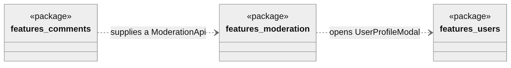

Diagram source (Mermaid)

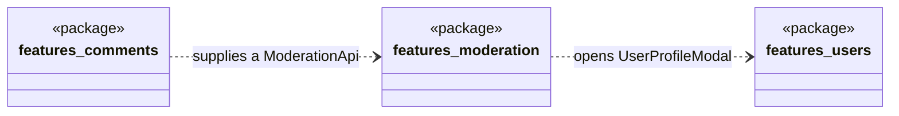

`comments` is a thin binding of two services onto the generic `moderation` screen —
see [diagram 4](#4-a-feature-in-detail-moderation). `moderation` reaches into
`users` for one component: the profile modal an operator opens from a reported
comment's author. Neither edge has a return edge.

### Inside a feature

Every feature is laid out the same way, which is why no diagram is drawn per feature:

| Directory | Holds | Depends on |
| --- | --- | --- |
| `<Feature>Page.tsx` | The screen | its own `hooks/` and `components/` |
| `components/` | Presentation | its own `model/` |
| `hooks/` | Reads, writes and cache keys | `@/api`, its own `model/` |
| `model/` | The feature's rules, as pure functions | `@/domain` only |

`model/` packages re-export explicitly by name — no `export *` — so the surface of a
feature's rules is a written list rather than whatever happens to be exported.

---

## 2. The API layer

One package per backend domain, each behind a barrel. A feature imports
`@/api/catalog`, never a service file.

Diagram source (Mermaid)

```mermaid
classDiagram
  direction TB

  namespace api_client {
    class ApiClient {
      +get(path, params) Promise~T~
      +post(path, body) Promise~T~
      +patch(path, body) Promise~T~
      +delete(path) Promise~T~
      +setToken(token)
      +setOnUnauthorized(handler)
    }
    class HttpTransport {
      <<interface>>
      +get(path, params) Promise~T~
      +post(path, body) Promise~T~
      +patch(path, body) Promise~T~
      +delete(path) Promise~T~
    }
    class ApiSession {
      +setToken(token)
      +setOnUnauthorized(handler)
      +hasToken() boolean
      +authorizationHeader() string
      +notifyUnauthorized()
    }
    class ApiRequestBuilder {
      +url(path) string
      +withQueryString(path, params) string
      +init(init) RequestInit
    }
    class ApiResponseParser {
      +parse(response, path) Promise~T~
    }
    class HttpService {
      <<abstract>>
      #client HttpTransport
    }
  }

  namespace api_errors {
    class ApiError {
      <<abstract>>
      +reason string
      +cause unknown
      +transient() boolean*
    }
    class NetworkError {
      +transient = true
    }
    class ContractError {
      +transient = false
    }
    class ResponseError {
      +status int
      +transient() status >= 500
    }
    class BadRequestError
    class UnauthorizedError
    class ForbiddenError
    class NotFoundError
    class ConflictError
    class RateLimitedError {
      +retryAfterSeconds int
    }
    class RefusedError {
      +transient = false
    }
  }

  namespace api_moderation {
    class ModerationService~TItem,TReport~ {
      <<abstract>>
      +getAll() Promise
      +update(id, update) Promise
      +delete(id) Promise
      +getReported() Promise
      +updateStatus(id, status) Promise
      +deleteReport(id) Promise
    }
    class ContentService~TItem~ {
      +getAll() Promise
      +update(id, update) Promise
      +delete(id) Promise
    }
    class ReportsService~TReport~ {
      +getReported() Promise
      +updateStatus(id, status) Promise
      +deleteReport(id) Promise
    }
    class CommentsService {
      resource = "comments"
    }
    class AnswersService {
      resource = "answers"
    }
  }

  namespace api_domains {
    class AuthService {
      +requestLoginCode(email) Promise
      +login(email, code) Promise
      +logout() Promise
      +me() Promise~AuthUser~
    }
    class UsersService {
      +list(query) Promise~UserPage~
      +getById(id) Promise~User~
      +update(id, update) Promise
      +delete(id) Promise
      +warn(id, message) Promise
      +getWarnings(id) Promise
    }
    class CatalogService {
      +getLectures() Promise
      +getProfessors() Promise
      +updateLecture(id, update) Promise
      +updateProfessor(id, update) Promise
      +deleteLecture(id) Promise
      +deleteProfessor(id) Promise
    }
    class RatingsService {
      +list(query) Promise~RatingPage~
      +delete(id) Promise
    }
    class FeedbackService {
      +getReports() Promise
      +updateReport(id, update) Promise
      +deleteReport(id) Promise
      +createGitlabIssue(id) Promise
      +isGitlabEnabled() Promise~boolean~
    }
    class AuditLogsService {
      +getLogs(filters) Promise~LogPage~
      +getLogs(filters, cursor) Promise~LogPage~
      +getMeta() Promise~LogMeta~
      +revert(id) Promise
    }
    class SystemStatusService {
      +getStatus() Promise~SystemStatus~
    }
  }

  ApiClient *-- ApiSession
  ApiClient *-- ApiRequestBuilder
  ApiClient *-- ApiResponseParser
  ApiClient ..|> HttpTransport
  ApiResponseParser ..> ApiError : throws
  HttpService --> HttpTransport

  NetworkError --|> ApiError
  ContractError --|> ApiError
  ResponseError --|> ApiError
  BadRequestError --|> ResponseError
  UnauthorizedError --|> ResponseError
  ForbiddenError --|> ResponseError
  NotFoundError --|> ResponseError
  ConflictError --|> ResponseError
  RateLimitedError --|> ResponseError
  RefusedError --|> ResponseError

  AuthService --|> HttpService
  UsersService --|> HttpService
  CatalogService --|> HttpService
  RatingsService --|> HttpService
  FeedbackService --|> HttpService
  AuditLogsService --|> HttpService
  SystemStatusService --|> HttpService
  ModerationService --|> HttpService

  ModerationService *-- ContentService
  ModerationService *-- ReportsService
  CommentsService --|> ModerationService
  AnswersService --|> ModerationService
```

Four things this diagram is drawn to make visible.

**A service is handed `HttpTransport`, not `ApiClient`.** This is the edge worth
pointing at. `ApiClient` publicly exposes `setToken` and `setOnUnauthorized`, so while
services held one, `BugReportsService` could revoke the operator's session and nothing
but convention stopped it. `HttpTransport` is four verbs and no session, so the
capability is not merely discouraged — it is absent from the type. `ApiClient`
implements it; only `src/context` ever holds the whole client.

**`HttpService` is a base class rather than a parameter property.**
`tsconfig.app.json` sets `erasableSyntaxOnly`, so
`constructor(private readonly client: HttpTransport)` is not available in this
project. Nineteen services had written the same field and the same constructor by
hand.

**`CommentsService` and `AnswersService` differ by one string.** The backend names
the list in each response after the resource — `/comments` returns `comments`,
`/answers` returns `answers` — so both are `ModerationService` with their noun
filled in. `ModerationService` *composes* `ContentService` and `ReportsService`
rather than inheriting from them: they are separate endpoint groups, and this is
only the seam that lets a page hold one service instead of two.

**`ApiClient` is where the cross-cutting session rules live**, not the services: the
bearer token, `401` ending the session, and an unreachable backend deliberately
**not** ending it — a rejected origin and a downed host are the same `TypeError` to
`fetch`, so the two cannot be told apart from here.

**Eleven error classes, and the hierarchy is the point.** `ApiError` was one class
carrying a `status`, thrown for five different things, with `status: 0` standing in
for three of them that are not HTTP failures at all. Callers then compared numbers, in
six files across four layers. Now every failure answers `transient` **for itself**, so
`src/query.ts`'s retry predicate compares no statuses, and `responseErrorFor` is the
one table that turns a number into a meaning. `ApiResponseParser` is the only code in
the panel that reads `response.status`.

The abstraction earns its keep outside the retry rule too: `AuthContext` decides
whether a failed session check is worth telling the operator about by asking
`error.transient`, not by listing statuses — so a `404` and an unreadable payload are
reported while a 500 and a dropped connection stay quiet, and nothing had to enumerate
which is which. [ADR 0013](adr/0013-errors-are-types-not-status-codes.md).

The `api_domains` grouping above is drawn for legibility. On disk these are five
separate packages — `auth`, `users`, `catalog`, `logs`, `feedback`, `system` — each
with its own barrel, and several are themselves split further (`AuditLogsService`
composes a reader, a meta service and a revert service).

---

## 3. The domain model

The entities the panel passes between layers. These are TypeScript `interface`
declarations, so they carry data and no behaviour; the rules that operate on them
live in each feature's `model/` package and in `src/domain`.

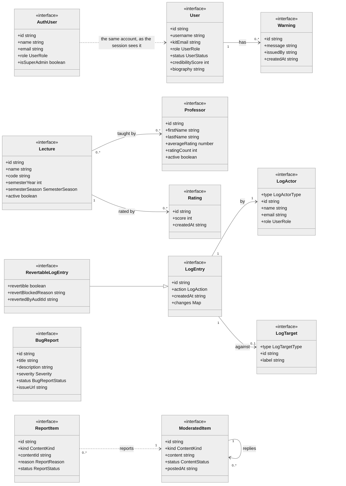

Diagram source (Mermaid)

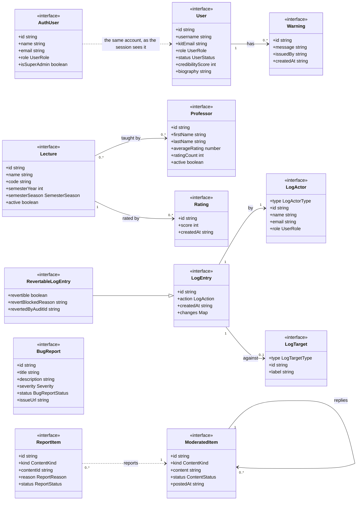

**`UserRole` is `'STUDENT' | 'ADMIN'` and has exactly two values.** The elevated
operator is `isSuperAdmin` on `AuthUser` — a behavioural privilege, not a third role.
See [ADR 0004](adr/0004-elevated-operator-is-behaviour-not-a-role.md).

**Every enum-shaped field is guarded at the boundary.** `src/domain/enumGuard.ts` is
a factory that builds the eight type guards (`isReportStatus`, `isUserStatus`, …) from
their vocabularies, with a `const` type parameter so a guard still narrows to the
literal union rather than to `string`. A value the backend sends that is outside the
vocabulary does not reach a component.

**`Lecture`–`Professor` is many-to-many**, which is why both edit forms accept an
empty array: `professorIds: []` and `lectureIds: []` clear an assignment rather than
meaning "unchanged".

---

## 4. A feature in detail: moderation

The richest feature, and the one that shows the pattern the others follow. The screen
is **generic over its resource**: `ModerationPage` does not know whether it is looking
at comments or answers.

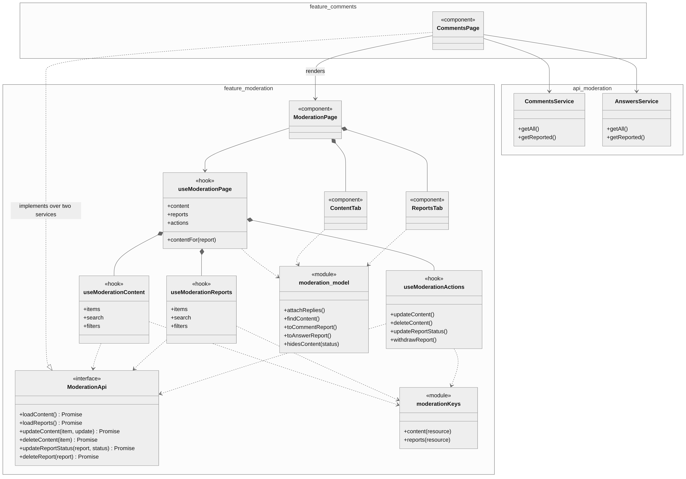

Diagram source (Mermaid)

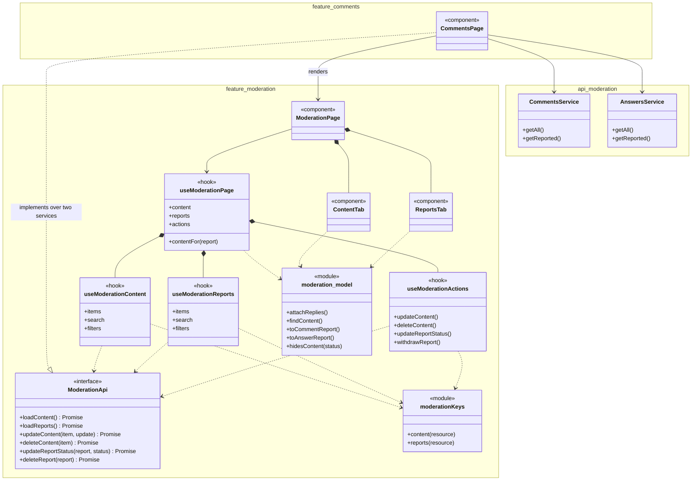

**This is the one genuine dependency inversion in the codebase.** `ModerationPage`
depends on the `ModerationApi` *interface*, and `CommentsPage` supplies an
implementation of it built from `CommentsService` and `AnswersService`. The generic
screen therefore has no import of either service, and a second moderated resource
would need a new binding page and nothing else.

**`useModerationPage` returns three objects, not twenty-four fields.** It used to
return them flat, and the page spread them across two tabs by hand —
`contentSearch` here, `reportStatusFilter` there. Each tab now takes the one group it
needs, which is the same shape `useCatalog` returns (`{ lists, actions }`).

**`moderationKeys` is why the generic screen works.** The cache key carries the
resource noun; without it, comments and answers would share a cache entry and show
each other's rows.

**All four writes invalidate both lists**, because the two lists are views of the same
records — setting a report to `ACTION_TAKEN` hides the content behind it. Only
withdrawing a report is narrower.

The other features have the same skeleton with fewer parts:

| Feature | Read hooks | Write hook | `model/` |
| --- | --- | --- | --- |
| `users` | `useUsersPage`, `useUserProfile` | `useUserProfileActions` | `filters`, `counts`, `access`, `confirmation`, `userEdit`, `userChange` |
| `catalog` | `useCatalogLists`, `useRatings` | `useCatalogActions` | `catalog`, `edit`, `deletion` |
| `feedback` | `useFeedbackReports` | `useFeedbackReportActions` | `reports`, `edit` |
| `audit-logs` | `useAuditLogs` | `useRevertAuditEntry` | `auditLogModel` |
| `dashboard` | `useDashboardData` | — | `dashboardModel` |
| `auth` | — | `useLoginFlow` | `loginModel`, `authenticateAdmin` |

---

## 5. The shell

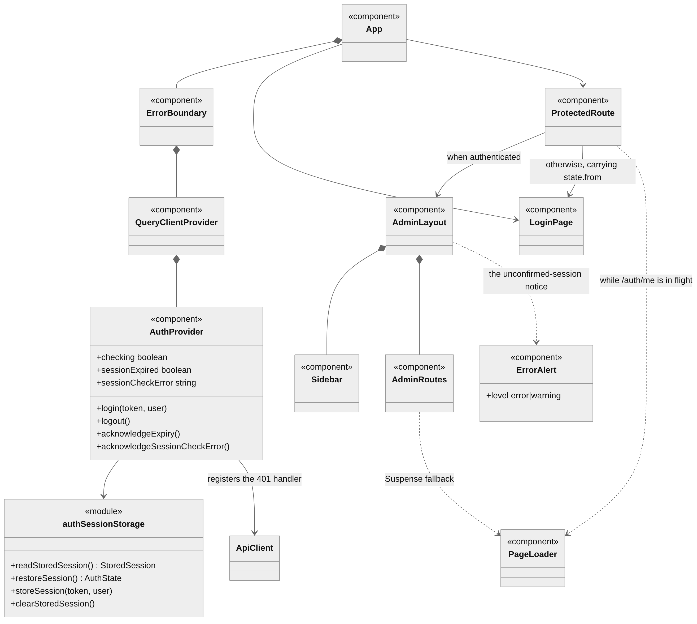

Diagram source (Mermaid)

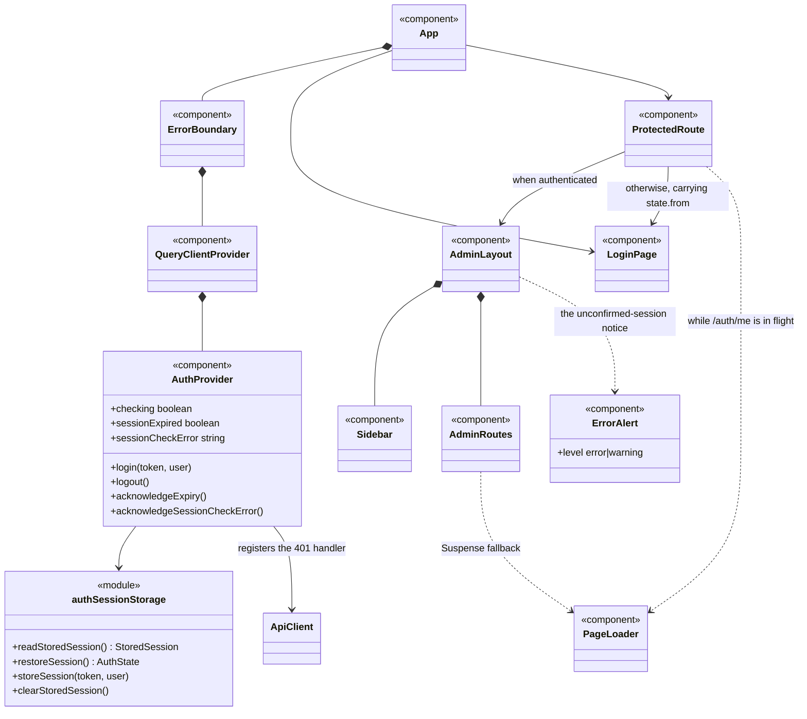

**The provider order is deliberate.** `QueryClientProvider` sits *inside* the error
boundary and *outside* `AuthProvider`, and the client is created with `useState` —
one per mounted app rather than one per module — so a test that renders `App` twice
cannot have the second render read the first one's cache.

**`ProtectedRoute` is authentication-only.** There is no role-based route or
navigation gating, by decision
([ADR 0004](adr/0004-elevated-operator-is-behaviour-not-a-role.md)). It stays on
`PageLoader` until `/auth/me` answers, rather than flashing the login screen at a
signed-in operator.

**Each page under `AdminRoutes` is a `React.lazy` chunk**, which is where the code
split lives — see [ADR 0007](adr/0007-route-based-lazy-loading.md).

**The provider carries three session states, not two.** `checking`, `sessionExpired`
and `sessionCheckError` answer three different questions — "we do not know yet", "the
backend refused", and "the backend answered, but not usefully" — and the panel owes
the operator a different screen for each. The third was missing entirely: a `404` on
`/auth/me` left the operator signed in against an unconfirmed account copy with
nothing on screen and nothing in state (`F-013`). `AdminLayout` renders it through the
same `ErrorAlert` a page uses for its own errors, at a `warning` level rather than an
`error` one, because the operator can carry on working through it.

---

## What these diagrams deliberately leave out

- **Presentational components.** There are around 90, and a diagram of them would be
  a picture of the JSX tree. Where one carries a decision — `ConfirmModal`,
  `ErrorAlert` vs `LoadError` — it is described in `README.md`, not drawn here.
- **Every service in a package.** `AuditLogsService` composes three; `UsersService`
  composes two; `CatalogService` composes lecture and professor services. Diagram 2
  shows the barrel's surface, which is what a caller sees.
- **Accessors.** Deliberately, per the notation note above.
- **Test files.** They sit beside the source and follow it.

## Keeping this true

The diagrams are derived from the code, not maintained in parallel with it. When a
feature gains or loses a hook, a `model/` package or a service, the affected diagram
is redrawn in the same commit — the same rule `docs/DESIGN.md` applies to the theme
and `CHANGELOG.md` applies to reasoning.
