# Admin Web Class Diagram

This diagram is intentionally high-level. The project is a React app, so most UI files are
function components rather than classes. The diagram treats components and hooks as named
units, then shows the main service and model relationships that matter when navigating the
codebase.

```mermaid
classDiagram
  direction LR

  namespace Shell {
    class App {
      <<component>>
      +routes
    }

    class AdminLayout {
      <<component>>
      +sidebar
      +outlet
    }

    class ProtectedRoute {
      <<component>>
      +requiresAuth
    }

    class AuthProvider {
      <<context>>
      +login()
      +logout()
      +sessionExpired
    }
  }

  namespace API {
    class ApiClient {
      +get(path, params)
      +post(path, body)
      +patch(path, body)
      +delete(path)
    }

    class HttpService {
      <<abstract>>
      #client
    }

    class ModerationService {
      <<abstract>>
      +getAll()
      +getReported()
      +update(id, update)
      +delete(id)
      +updateStatus(id, status)
      +deleteReport(id)
    }

    class ContentService~TItem~ {
      +getAll()
      +update(id, update)
      +delete(id)
    }

    class ReportsService~TReport~ {
      +getReported()
      +updateStatus(id, status)
      +deleteReport(id)
    }

    class AuthService {
      +requestLoginCode(email)
      +login(email, code)
      +logout()
      +me()
    }

    class UsersService {
      +list(query)
      +getById(id)
      +update(id, update)
      +delete(id)
      +warn(id, message)
      +getWarnings(id)
    }

    class CatalogService {
      +getLectures()
      +getProfessors()
      +updateLecture(id, update)
      +updateProfessor(id, update)
      +deleteLecture(id)
      +deleteProfessor(id)
    }

    class CommentsService {
      +resource = "comments"
    }

    class AnswersService {
      +resource = "answers"
    }

    class RatingsService {
      +list(query)
      +delete(id)
    }

    class FeedbackService {
      +getReports()
      +updateReport(id, update)
      +deleteReport(id)
      +createGitlabIssue(id)
    }

    class AuditLogsService {
      +getLogs(filters, cursor)
      +getMeta()
      +revert(id)
    }

    class SystemStatusService {
      +getStatus()
    }
  }

  namespace Features {
    class LoginPage {
      <<component>>
    }

    class DashboardPage {
      <<component>>
    }

    class UsersPage {
      <<component>>
    }

    class CatalogPage {
      <<component>>
    }

    class CommentsPage {
      <<component>>
    }

    class ModerationPage {
      <<component>>
    }

    class FeedbackPage {
      <<component>>
    }

    class AuditLogsPage {
      <<component>>
    }
  }

  namespace Hooks {
    class useLoginFlow {
      <<hook>>
      +requestCode()
      +verifyCode()
    }

    class useDashboardData {
      <<hook>>
      +stats
      +users
      +retry()
    }

    class useUsersPage {
      <<hook>>
      +applyFilters()
      +loadMore()
    }

    class useUserProfile {
      <<hook>>
      +warn()
      +update()
      +block()
      +unblock()
      +remove()
    }

    class useCatalog {
      <<hook>>
      +lectures
      +professors
      +updateLecture()
      +updateProfessor()
    }

    class useRatings {
      <<hook>>
      +ratings
      +loadMore()
      +deleteRating()
    }

    class useModerationPage {
      <<hook>>
      +content
      +reports
      +actions
    }

    class ModerationApi {
      <<interface>>
      +loadContent()
      +loadReports()
      +updateContent()
      +deleteContent()
      +updateReportStatus()
      +deleteReport()
    }

    class useFeedbackReportActions {
      <<hook>>
      +applyUpdate()
      +createIssue()
      +deleteReport()
    }

    class useAuditLogs {
      <<hook>>
      +applyFilters()
      +clearFilters()
      +loadMore()
      +reload()
    }
  }

  namespace Models {
    class AuthUser {
      <<interface>>
      +id
      +name
      +email
      +role
      +isSuperAdmin
    }

    class User {
      <<interface>>
      +id
      +username
      +kitEmail
      +role
      +status
      +warnings
      +reports
    }

    class Warning {
      <<interface>>
      +id
      +userID
      +message
      +issuedBy
    }

    class Lecture {
      <<interface>>
      +id
      +name
      +code
      +semesterYear
      +semesterSeason
      +professors
    }

    class Professor {
      <<interface>>
      +id
      +firstName
      +lastName
      +lectureIds
      +averageRating
    }

    class BugReport {
      <<interface>>
      +id
      +title
      +severity
      +status
      +issueUrl
    }

    class ModeratedItem {
      <<interface>>
      +id
      +kind
      +content
      +status
      +replies
    }

    class ReportItem {
      <<interface>>
      +id
      +kind
      +contentId
      +reason
      +status
    }

    class LogEntry {
      <<interface>>
      +id
      +action
      +createdAt
      +actor
      +target
      +changes
    }

    class RevertableLogEntry {
      <<interface>>
      +revertible
      +revertBlockedReason
      +revertedByAuditId
    }

    class DashboardStats {
      <<interface>>
      +total
      +active
      +admins
      +openReports
    }
  }

  App --> AuthProvider : wraps
  App --> ProtectedRoute : protects admin routes
  ProtectedRoute --> AdminLayout : renders when authenticated
  AuthProvider --> AuthService : verifies session
  useLoginFlow --> AuthService : requests and verifies login
  useLoginFlow --> AuthProvider : stores session

  HttpService --> ApiClient : holds
  AuthService --|> HttpService
  UsersService --|> HttpService
  CatalogService --|> HttpService
  RatingsService --|> HttpService
  FeedbackService --|> HttpService
  AuditLogsService --|> HttpService
  SystemStatusService --|> HttpService

  ModerationService --|> HttpService
  ModerationService --> ContentService : composes
  ModerationService --> ReportsService : composes
  CommentsService --|> ModerationService
  AnswersService --|> ModerationService

  LoginPage --> useLoginFlow
  DashboardPage --> useDashboardData
  UsersPage --> useUsersPage
  UsersPage --> useUserProfile
  CatalogPage --> useCatalog
  CatalogPage --> useRatings
  CommentsPage --> ModerationPage
  ModerationPage --> useModerationPage
  FeedbackPage --> useFeedbackReportActions
  AuditLogsPage --> useAuditLogs

  useDashboardData --> SystemStatusService
  useDashboardData --> UsersService
  useUsersPage --> UsersService
  useUserProfile --> UsersService
  useCatalog --> CatalogService
  useRatings --> RatingsService
  useModerationPage --> ModerationApi
  useFeedbackReportActions --> FeedbackService
  useAuditLogs --> AuditLogsService

  CommentsPage ..|> ModerationApi : adapts comments and answers
  CommentsPage --> CommentsService
  CommentsPage --> AnswersService

  AuthService ..> AuthUser : returns
  UsersService ..> User : returns
  UsersService ..> Warning : returns
  CatalogService ..> Lecture : returns
  CatalogService ..> Professor : returns
  RatingsService ..> Lecture : filters by
  FeedbackService ..> BugReport : returns
  CommentsService ..> ModeratedItem : mapped to
  AnswersService ..> ModeratedItem : mapped to
  CommentsService ..> ReportItem : mapped to
  AnswersService ..> ReportItem : mapped to
  AuditLogsService ..> RevertableLogEntry : returns
  useDashboardData ..> DashboardStats : derives

  User "1" --> "0..*" Warning : has
  Lecture "1" --> "0..*" Professor : assigned
  ModeratedItem "1" --> "0..*" ModeratedItem : replies
  RevertableLogEntry --|> LogEntry
```

## How To Read It

- `API` contains the service classes that talk to the backend through `ApiClient`,
  grouped into one package per domain (`client`, `auth`, `users`, `moderation`,
  `catalog`, `logs`, `feedback`, `system`), each with a barrel. Every service
  extends `HttpService`, which holds the client.
- `CommentsService` and `AnswersService` are the same generic `ModerationService`
  with their noun filled in; comments and answers are the same endpoints under a
  different resource name.
- Data loading is TanStack Query on the audit log, users and moderation screens.
  The dashboard, catalogue and feedback still use the hand-rolled `useAsyncData`.
- `Hooks` contain stateful page logic. Most feature pages delegate data loading and mutation
  flows to these hooks.
- `Features` are the top-level screens and reusable page components.
- `Models` are the main TypeScript interfaces passed between services, hooks, and components.
- `CommentsPage` adapts both `CommentsService` and `AnswersService` into the shared
  `ModerationApi`, so `ModerationPage` can stay generic.
