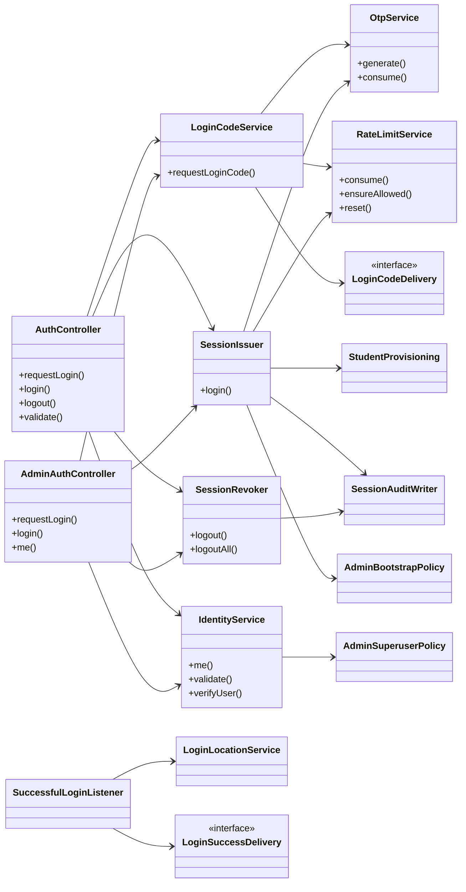
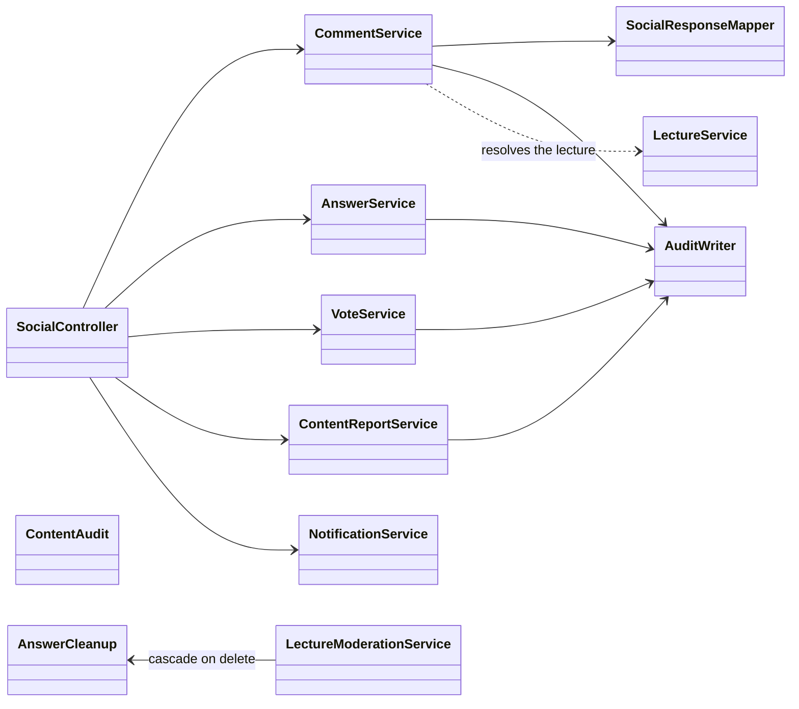
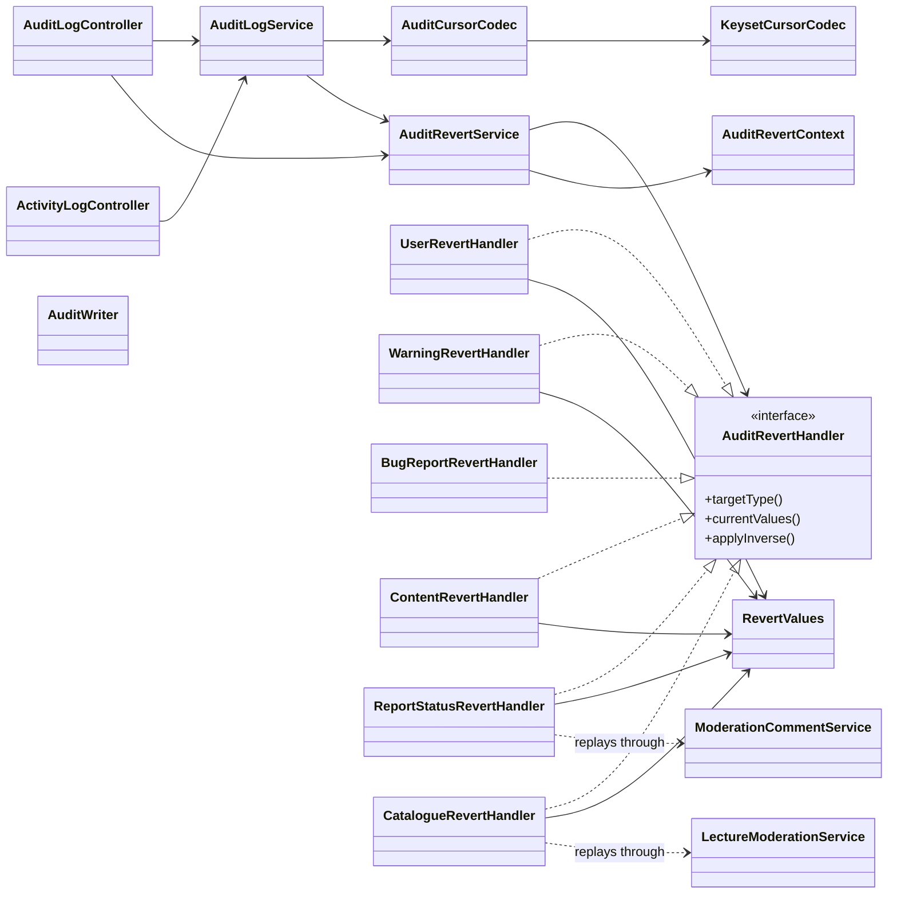
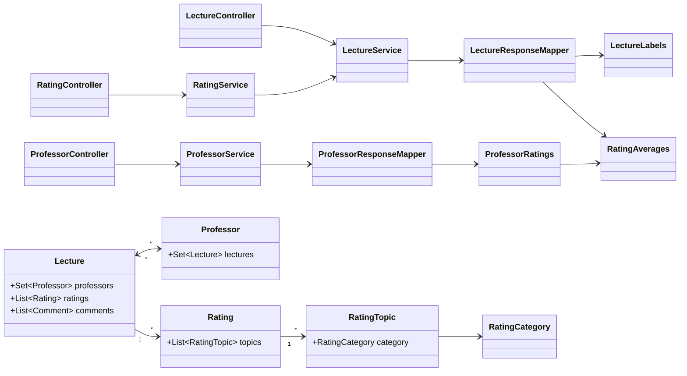
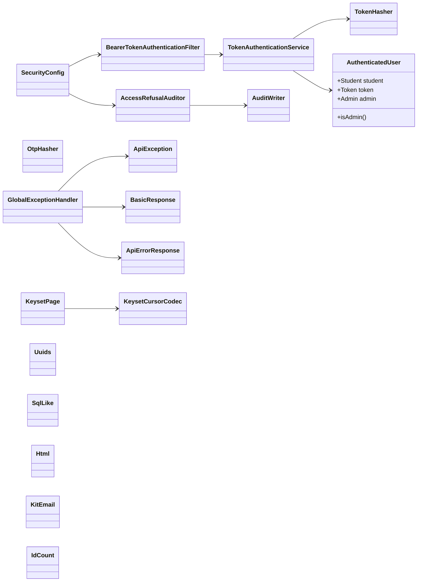

# Klassendiagramme

Six diagrams, one per bounded area, using the names the code has **after** the
single-responsibility refactor ([ADR 0008](adr/0008-single-responsibility-refactor.md)). If you
are holding an older diagram, the old-to-new mapping is in
[test-plan.md](test-plan.md#the-single-responsibility-refactor).

**What is drawn, and what is left out on purpose.** Collaborators, taken from constructor
injection — so an arrow means "this class cannot be built without that one", which is the
relationship that actually constrains the design. **No getters or setters**: every entity here
is a Lombok `@Getter @Setter` record of its columns, and drawing thirty accessors per box would
bury the two or three relationships that matter. Entities are drawn with their **relations**,
not their fields.

Arrows read **depends on** (`-->`) unless labelled. `..|>` is *implements*.

One diagram per area rather than one whole-application picture: the whole thing is 256 classes
and a single graph of it is a picture of nothing.

---

## 1. `com.pse.auth` — getting a session, and what a session costs

The area with the most collaborators, because logging in touches rate limiting, one-time codes,
mail delivery, audit and two different session schedules.

**Two things the picture is for.** `LoginCodeDelivery` and `LoginSuccessDelivery` are
*interfaces*, and that is the seam every test substitutes — the real SMTP adapter is never
constructed in a test, which is why `MailService` sits under *Deliberately uncovered* rather
than being a gap. And **which controller you log in through decides the session**, not who you
are: both controllers reach the same `SessionIssuer`, and the schedule is a property of the
endpoint.

---

## 2. `com.pse.social` — comments, answers, votes, reports

What `SocialService` (591 lines) became.

`ContentAudit` and `SocialResponseMapper` are the two pieces the five services must **not**
each own a copy of: the audit metadata rule (a 120-character preview) and the `userVote`
decision, which has three states that look alike from outside.

---

## 3. `com.pse.moderation` — the administrative surface

The largest area, and the one where the twin pairs live.

```mermaid
classDiagram
    direction TB

    class ModerationUserController
    class ModerationCommentController
    class ModerationAnswerController
    class ModerationCatalogController
    class ModerationRatingController
    class ModerationBugReportController

    class UserDirectoryService
    class StudentProfileService
    class StudentLifecycleService
    class WarningService
    class ModeratedStudents

    class ContentModerationService
    class ModerationCommentService
    class ModerationAnswerReportService
    class ReportOutcome

    class LectureModerationService
    class ProfessorModerationService
    class CatalogueEdits

    class RatingModerationService
    class ModerationBugReportService
    class BugReportIssueTransactions
    class GitLabClient {
        <<interface>>
    }
    class RestClientGitLabClient

    class UserResponseMapper
    class UserReferenceMapper

    ModerationUserController --> UserDirectoryService
    ModerationUserController --> StudentProfileService
    ModerationUserController --> StudentLifecycleService
    ModerationUserController --> WarningService

    UserDirectoryService --> UserResponseMapper
    StudentProfileService --> ModeratedStudents
    StudentLifecycleService --> ModeratedStudents
    WarningService --> ModeratedStudents

    ModerationCommentController --> ContentModerationService
    ModerationCommentController --> ModerationCommentService
    ModerationAnswerController --> ContentModerationService
    ModerationAnswerController --> ModerationAnswerReportService
    ModerationCommentService --> ReportOutcome
    ModerationAnswerReportService --> ReportOutcome

    ModerationCatalogController --> LectureModerationService
    ModerationCatalogController --> ProfessorModerationService
    LectureModerationService --> CatalogueEdits
    ProfessorModerationService --> CatalogueEdits

    ModerationRatingController --> RatingModerationService
    ModerationBugReportController --> ModerationBugReportService
    ModerationBugReportService --> BugReportIssueTransactions
    ModerationBugReportService --> GitLabClient
    RestClientGitLabClient ..|> GitLabClient

    UserResponseMapper ..> UserReferenceMapper
```

**`ModerationCommentService` and `ModerationAnswerReportService` are deliberately still two
classes** — the same 150 lines twice. Merging them was measured and declined: thirteen abstract
methods to save a hundred and twenty lines. The **one** rule that could silently diverge —
`ACTION_TAKEN` being the only status that hides content — is extracted as `ReportOutcome`,
which is why both point at it.
`CatalogueEdits` is the same idea for the lecture/professor pair.

---

## 4. `com.pse.audit` and `com.pse.audit.revert` — the trail, and undoing one field

**The dashed arrows out of the handlers are the design.** `applyInverse` does not write fields
itself; it calls the same service the panel calls, so a revert goes through every guard and
writes its own audit entry. `ContentRevertHandler`, `ReportStatusRevertHandler` and
`CatalogueRevertHandler` each hold **two** `@Component` inner classes (comment/answer,
lecture/professor) — nine handler beans from six files, and the pairs are where
[F-31](test-findings.md#f-31--reverting-a-report-status-is-impossible-on-exactly-the-changes-worth-reverting)
was found.

---

## 5. `com.pse.lecture` / `professor` / `rating` — the catalogue and what it is judged by

**The many-to-many is the one worth looking at.** `Lecture.professors` is a `Set`, and
`Professor` overrides neither `equals` nor `hashCode` — so its iteration order is the JVM's and
can differ per run. That is BUG-3, F-21 and half of
[F-35](test-findings.md#f-35--four-more-lists-reaching-the-client-with-no-defined-order), all
from this one edge. Both mappers sort explicitly because of it.

`ProfessorRatings` exists because two unrelated places need the same walk — every rating on
every lecture a professor teaches — and must not disagree about it.

---

## 6. `com.pse.security` and `com.pse.shared` — the chain, and what everything reuses

**`AuthenticatedUser` is the reason the ownership sweep found no IDOR.** Every app-tier handler
takes the caller's identity from `@AuthenticationPrincipal` and never from the request, and
`ApiOwnershipMatrixTests` pins that structurally by reflection over every handler and its
`@RequestBody` type — the invariant, rather than one probe per route, is what keeps the
owner-scoped column one line long.

The `shared` classes exist because each had **two or three copies** before the refactor:
`Html.escape` in two classes, `KitEmail`'s rule in three places, the paging block in three
listings, `toCountMap` in two services. Each one now has one home and its own tests.
