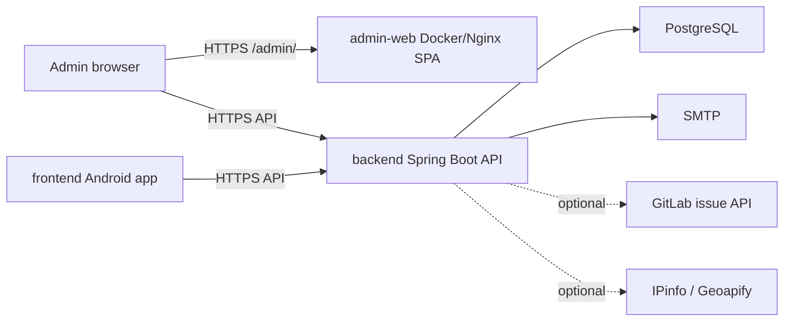

# Deployment Overview

This document is the cross-repository deployment overview for the Rate My
Professor system. It covers only these repositories:

- `backend`
- `admin-web`
- `frontend`

Component-specific commands and configuration belong in the repository that owns
the component. If a component guide conflicts with that repository's CI, build
files, or deployment scripts, fix the component guide together with the code.

## Component Guide Index

| Component | Responsibility | Authoritative guide |
| --- | --- | --- |
| Backend | Spring Boot API, PostgreSQL persistence, server-side integrations, Docker image, and BW Cloud deployment | <https://gitlab.kit.edu/kit/pse-android-app/backend/-/blob/main/docs/deployment.md> |
| Admin Web | React/Vite administration interface, production Docker/Nginx image, and `/admin/` deployment | <https://gitlab.kit.edu/kit/pse-android-app/admin-web/-/blob/main/docs/deployment.md> |
| Android frontend | Android app build, APK packaging, client API contract, and distribution preparation | <https://gitlab.kit.edu/kit/pse-android-app/frontend/-/blob/main/docs/deployment.md> |

The root `README.md` of each repository should link to its own deployment guide
and to this overview.

## System Context



Only `backend`, `admin-web`, and `frontend` are deployable code repositories in
scope here. PostgreSQL, SMTP, reverse proxying, and optional external APIs are
runtime dependencies, not separate component repositories for this overview.

## Confirmed Shared Environment

| Item | Confirmed current value | Notes |
| --- | --- | --- |
| Shared BW Cloud host / backend API base URL | `https://<course-host>` | Used by the backend health check, Admin Web CI, Admin Web deploy script, and Android `RetrofitClient.BASE_URL`. |
| Backend health endpoint | `/health` | Public endpoint. Returns HTTP 200 only when the backend can query PostgreSQL. |
| Admin Web public URL | `https://<course-host>/admin/` | Admin Web is built with `VITE_BASE_PATH=/admin/`. |
| Admin Web production container | `admin-web-prod` | Serves static files with Nginx on container port 80; the deployment host maps it to `127.0.0.1:${WEB_PORT:-8081}`. |
| Backend production/staging container | `app-server` | Backend listens on container port 8080; production Compose and CI publish it on host loopback as `127.0.0.1:8080` by default. Public API traffic should arrive through the HTTPS reverse proxy. |
| PostgreSQL location | Deployment host via `host.docker.internal:5432` by default | The backend CI default datasource URL is `jdbc:postgresql://host.docker.internal:5432/postgres`. |
| Android distribution channel | Not confirmed | CI produces APK artifacts but does not deploy them. Release builds currently set `BuildConfig.SKIP_LOGIN=true`; treat that as a release blocker unless it is intentional for the distribution channel. |
| Environment classification | Not consistent | The backend job is named `server:deploy:staging`; Admin Web CI names the environment `production`. Confirm whether this host is staging, production, or both before release. |

## Cross-Component Contracts

- The Admin Web and Android app both depend on the backend API contract. Backend
  changes should remain backward compatible whenever older Android installations
  may still be in use.
- The Admin Web backend address is baked into the frontend bundle through
  `VITE_API_BASE_URL` at build time. Current Admin Web CI sets it to
  `https://<course-host>`.
- Changing the Admin Web API base URL or base path requires rebuilding and
  redeploying the Admin Web image.
- The Admin Web is currently served from `/admin/`, and direct route verification
  must use prefixed paths such as
  `https://<course-host>/admin/login`.
- The Android backend address is hardcoded in
  `frontend/app/src/main/java/com/example/ratemyprofessor/ServerCommunication/RetrofitClient.java`.
  Changing it requires rebuilding and redistributing the Android app.
- The backend CORS allow-list is configured through `ADMIN_FRONTEND_ORIGINS`.
  When Admin Web is served from a different origin, this variable must contain
  the exact Admin Web origin. The backend CI currently defaults it to the BW
  Cloud origin shown above.
- The backend requires a valid `AUTH_RATE_LIMIT_HMAC_KEY` at startup. It must be
  at least 32 characters.
- Secrets belong in protected deployment or CI/CD configuration. They must not
  be committed or copied into this overview.

## Source of Truth

Use this overview for:

- component dependencies and release order;
- shared hostnames and URL paths;
- API compatibility decisions;
- cross-component smoke tests;
- rollback coordination.

Use the component guides for:

- exact build and deployment commands;
- tool and runtime versions;
- repository-specific CI/CD jobs;
- environment-variable definitions;
- database behavior;
- signing and packaging details;
- component-specific troubleshooting.

## Coordinated Deployment Procedure

### 1. Select Compatible Revisions

1. Record the backend, Admin Web, and Android commit SHA or release tag.
2. Review backend API changes against both clients.
3. Stop the deployment if client compatibility is unclear, required
   configuration is missing, or the current BW Cloud host has not been
   classified for the release.

### 2. Deploy Backend

Follow the backend guide.

Confirmed current path:

- `server:package` builds and pushes
  `$CI_REGISTRY_IMAGE/server:$CI_COMMIT_SHORT_SHA`.
- Manual `server:deploy:staging` replaces the Compose-managed `app-server`
  Docker container.
- The backend host port is published on loopback as `127.0.0.1:8080` by
  default; do not expose the container directly on `0.0.0.0`.
- The deploy job checks `http://localhost:8080/health` inside the container.
- A scheduled `health:check` checks the public BW Cloud `/health` endpoint.
- A scheduled `backup:offsite` copies the newest host-side PostgreSQL dump,
  verifies it, encrypts it with `BACKUP_PASSPHRASE`, and stores only the
  encrypted artifact.

Before deployment:

- confirm protected CI/CD variables are present;
- confirm the PostgreSQL target and credentials;
- take or verify a database backup before schema-affecting changes;
- confirm `AUTH_RATE_LIMIT_HMAC_KEY`;
- confirm Flyway baseline settings, especially
  `SPRING_FLYWAY_BASELINE_ON_MIGRATE=false` for the database baselined on
  2026-09-05;
- confirm `ADMIN_FRONTEND_ORIGINS` when cross-origin access is expected;
- record a known-good backend image tag for rollback.

Deployment gate:

```bash
curl -fsS https://<course-host>/health
```

Do not continue until the endpoint returns HTTP 200 and backend logs show no
startup, database, or configuration errors.

### 3. Deploy Admin Web

Follow the Admin Web guide.

Confirmed current path:

- `web:image` builds the Docker `web-prod` target with Kaniko.
- The image is pushed as `$CI_REGISTRY_IMAGE:$CI_COMMIT_SHORT_SHA` and `latest`.
- Manual `web:deploy` pulls the image on the deployment host.
- The job replaces the `admin-web-prod` container.
- The container is published on host loopback as
  `127.0.0.1:${WEB_PORT:-8081}:80`.
- The container is checked at
  `http://127.0.0.1:${WEB_PORT:-8081}/admin/`.

Before deployment:

- confirm `VITE_API_BASE_URL`;
- confirm `VITE_BASE_PATH=/admin/`;
- confirm `PUBLIC_URL` points to the public Admin Web URL;
- confirm the host reverse proxy forwards `/admin/` to the Admin Web container;
- confirm `/admin/` and `/admin/login` are served by the Nginx SPA fallback;
- confirm a previous image or older successful pipeline is available for
  rollback.

Deployment gates:

- open
  `https://<course-host>/admin/`;
- open `/admin/login` directly and confirm the SPA loads;
- confirm browser network requests use the intended backend URL;
- complete a non-destructive administrator workflow;
- confirm authenticated admin calls can reach the backend.

### 4. Build and Distribute Android

Follow the Android frontend guide.

Confirmed current state:

- CI runs lint, unit tests, optional instrumentation tests, debug build, and
  release packaging.
- `android:package` builds release APK artifacts on `main`.
- There is no CI deployment stage.
- No production signing configuration is defined in `app/build.gradle.kts`.
- `versionCode` is currently `1`; `versionName` is currently `1.0`.
- Debug builds set `BuildConfig.SKIP_LOGIN=false`; release builds currently set
  it to `true`.

Before distribution:

- confirm the hardcoded backend URL is correct;
- confirm API compatibility with the deployed backend;
- update versioning according to the release policy;
- change or explicitly approve the release `BuildConfig.SKIP_LOGIN` value;
- configure release signing without committing keystores or credentials;
- select the distribution channel.

Deployment gates:

- install the release candidate on a clean device or emulator;
- confirm the login flow is reachable;
- complete login with an authorized test procedure;
- confirm profile and search data load;
- confirm comments or ratings load for a lecture offering.

Until signing and distribution are documented, an Android release APK is a build
artifact, not a complete production deployment.

## End-to-End Release Checklist

- [ ] Backend, Admin Web, and Android revisions recorded.
- [ ] API compatibility reviewed.
- [ ] Database backup completed when required.
- [ ] Backend deployed and `/health` returns HTTP 200.
- [ ] Backend logs checked.
- [ ] Admin Web image built with the intended `VITE_API_BASE_URL` and
      `VITE_BASE_PATH`.
- [ ] `/admin/` and `/admin/login` verified.
- [ ] Admin Web authenticated workflow verified.
- [ ] Android backend target, version, signing, and release `SKIP_LOGIN` value
      verified.
- [ ] Android release candidate tested on a clean device or emulator.
- [ ] One end-to-end user flow verified through every released client.
- [ ] Known-good rollback target recorded for backend and Admin Web.
- [ ] Android corrective-release path identified.
- [ ] Release result and remaining issues communicated to the team.

## Rollback Coordination

Rollback the smallest affected component when API and data compatibility allow
it. Coordinate a broader rollback when backend, client, or database state would
otherwise become incompatible.

| Component | Current rollback boundary | Required improvement |
| --- | --- | --- |
| Backend | Redeploy a known-good commit-tagged backend container image. | Document and test the exact redeploy command or process. Confirm database compatibility before rolling back application code. |
| Admin Web | Rerun `web:deploy` for an older successful pipeline image, or deploy from an older commit with `scripts/deploy-prod.ps1`. | Document the preferred rollback path and confirm whether any host proxy reload or cache purge is needed. |
| Android frontend | Already-installed clients cannot be centrally rolled back by this repository. | Define the distribution channel and corrective-release process. Maintain backend compatibility with supported older clients. |

After rollback, repeat the affected component checks and the end-to-end smoke
tests.

## Documentation Maintenance

- A merge request that changes build, configuration, CI/CD, deployment,
  migration, signing, distribution, or verification behavior must update the
  deployment guide in the same repository.
- Update this overview only when a shared endpoint, cross-repository dependency,
  deployment order, compatibility rule, ownership boundary, rollback rule, or
  system-level verification step changes.
- Never place credentials, tokens, private keys, OTPs, or real user data in this
  document.